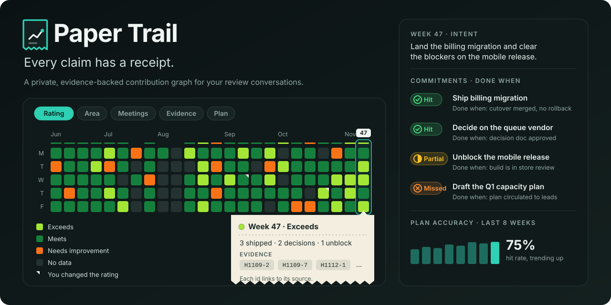
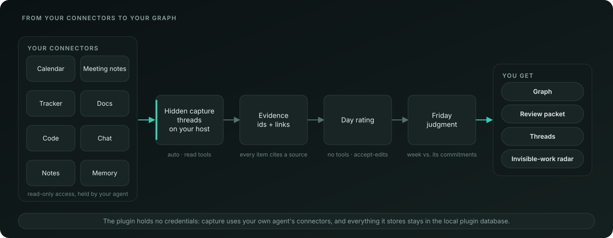
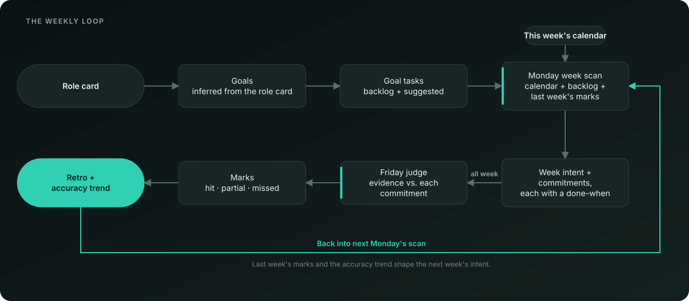
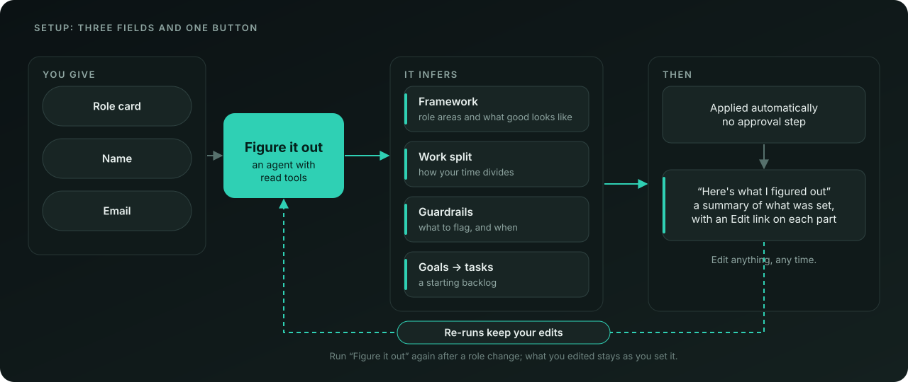
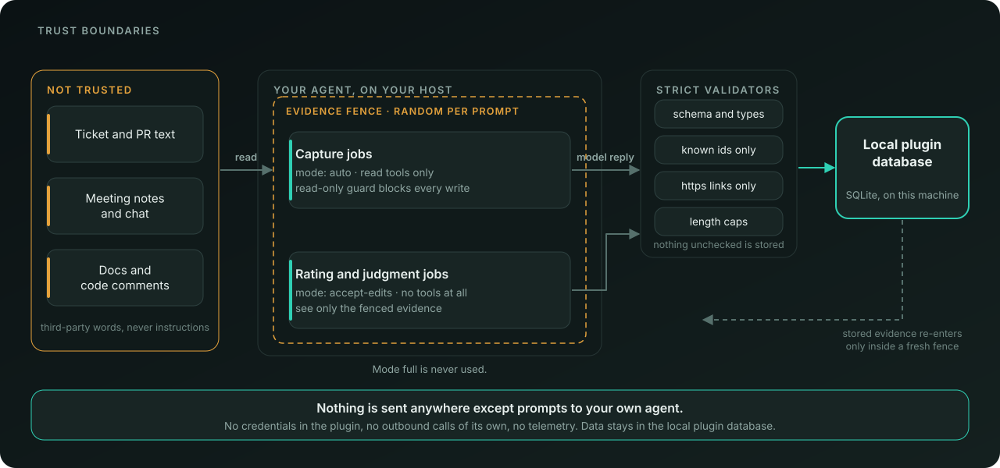

<p align="center">
  
</p>

<p align="center">
  <a href="#install"><b>Install</b></a>&nbsp;&nbsp;·&nbsp;&nbsp;
  <a href="docs/how-it-works.md"><b>How it works</b></a>&nbsp;&nbsp;·&nbsp;&nbsp;
  <a href="docs/privacy-and-security.md"><b>Privacy &amp; security</b></a>&nbsp;&nbsp;·&nbsp;&nbsp;
  <a href="CHANGELOG.md"><b>Changelog</b></a>&nbsp;&nbsp;·&nbsp;&nbsp;
  <a href="CONTRIBUTING.md"><b>Contributing</b></a>&nbsp;&nbsp;·&nbsp;&nbsp;
  <a href="https://github.com/sponsors/vanZeben">♥&nbsp;Sponsor</a>
</p>

<p align="center">
  <a href="https://github.com/vanZeben/bb-paper-trail/releases"></a>
  <a href="https://github.com/vanZeben/bb-paper-trail/actions/workflows/ci.yml"></a>
  
  <a href="LICENSE.md"></a>
</p>

---

**Paper Trail is a [bb](https://getbb.app) plugin that keeps a private, evidence-backed contribution graph of your engineering work.**

A lot of what you do, you don't actually think about or remember: the review that unblocked a teammate, the design thread you settled, the meeting that changed a plan. Come review season you are reconstructing a year from memory. Paper Trail does the remembering as you go. Each workday is captured from the tools you already use, rated against your role, and drawn as a cell on a GitHub-style graph. Every rating and every claim in a weekly summary links back to the meeting, ticket, pull request, doc or chat thread it came from, so a performance-review conversation starts from evidence.

It holds no credentials and needs almost no setup. You give it a role card, your name and your email; the agent works out the rest.

## Why Paper Trail

- **Evidence, not vibes.** Every rating cites evidence ids, and every id links to its source over https. A claim you cannot trace does not make it into a summary.
- **Zero-config.** No rubric to write, no targets to tune. The agent infers your role areas and rubric, your work split, guardrails, goals broken into tasks, and your manager (from a recurring 1:1 on your calendar), then applies them. Everything stays editable afterwards.
- **No credentials in the plugin.** Capture runs as hidden agent threads that use *your agent's own connectors* (claude.ai or MCP: calendar, meeting notes, Jira and Confluence, GitHub through `gh` or MCP, Slack, notes, memory). Paper Trail never sees a token.
- **Private by construction.** Data lives in the bb server's plugin database. The only thing that leaves your machine is prompts to your own agent. See [Privacy &amp; security](#privacy--security).
- **A week loop, not just a record.** On Monday it scans your meetings and backlog and writes an intent for the week with "done when" marks. On Friday it marks each commitment hit, partial or missed and tracks how accurate your plans are.
- **You stay in charge.** Confirm or override any AI rating, edit any section, and export everything as a bundle.

## How it works

<p align="center"></p>

Capture, rating and judgment are separate jobs. Capture reads (calendar, meeting notes, tracker, docs, code host, chat, notes, memory) and returns strictly validated evidence. Rating and judgment use no tools at all: everything they need is in the prompt, which keeps them cheap to reason about and hard to hijack. [How it works](docs/how-it-works.md) has the details, including what each coverage state means.

## The week loop

<p align="center"></p>

Goals (inferred from your role card) are mapped to concrete tasks from your backlog, plus suggested next steps. The Monday scan turns your calendar, backlog and last week's marks into an intent and three to five commitments, each with a "done when" line. Friday's judgment marks each one, writes a retro, and the plan-accuracy trend calibrates the next scan ("your plans hit 55%, so propose fewer, sharper commitments"). Planning also runs right after setup and on demand from the Week tab. A plan you edit by hand is never overwritten.

## Setup in one step

<p align="center"></p>

Open Paper Trail in bb and the onboarding asks for three things: your name, your email, and a role card (upload a `.md` or `.txt`, paste it, or give a note path or URL for the agent to read). Press **Figure it out**. The agent infers everything else, shows what it decided and why in a "Here's what I figured out" screen, and starts a backfill of the last four weeks. Edit any of it later in Settings.

## Features

**Graph.** A contribution graph of your rated days, with lenses: **rating**, **role area**, **meeting load**, **evidence volume** and **plan**. Click a day or week for its rating, reasoning, claims, coverage and evidence links. Confirm or override the AI's rating with a note; overrides feed back into later prompts as calibration examples.

**Time.** Your actual split of time across role areas against a target, with weekly drift, plus guardrails that flag patterns worth a look (meeting load, an area missed for weeks, open asks going stale, a source failing, too many threads in flight).

**Week.** This week's intent, commitments with "done when" marks, the shape of the week (meeting hours against focus hours, key meetings, what was deferred from the backlog), last week's marks and retro, the plan-accuracy trend, and goals with their tasks.

**Threads.** Work that spans weeks, derived from the claims and links in your weekly judgments, with a status (active, shipped, stale, at risk, closed). The agent drafts a closure note (expectation, result, learnings) from evidence; yours always win.

**Review.** A review packet for any date range: ratings, claims, threads and closures, goals, time split and gaps, as markdown with evidence links, plus an optional agent-written narrative. Copy it, download it, or save it to a notes folder you choose.

**Invisible work radar.** Surfaces clusters of substantive evidence (help given, reviews, decisions) that no rating, claim or commitment cites, so you can claim it as a note or raise it.

**Settings.** Profile and setup, goals, role framework, work split, guardrails, plan, sources and connectors, data import and export, and advanced settings. Each inferred section shows why the agent chose it.

## Install

From a terminal, until Paper Trail is listed in the bb marketplace:

```sh
bb plugin install git:https://github.com/vanZeben/bb-paper-trail.git
```

Or from a local checkout:

```sh
git clone https://github.com/vanZeben/bb-paper-trail.git
cd bb-paper-trail
npm ci
bb plugin install .
```

Once listed, install from **Settings → Plugins** or with `bb plugin install`. Paper Trail needs bb 0.50 or later and at least one bb host whose agent has the connectors you want captured.

## Quick start

1. **Open Paper Trail** in the bb sidebar. The connector check runs on its own and shows which sources your agent can reach.
2. **Give it your name, your email and a role card**, then press **Figure it out**.
3. **Read "Here's what I figured out"** and fix anything that looks off, or press **Looks good**.
4. **Wait for the backfill** of the last four weeks (watch it with `bb paper-trail status`). From then on, each finished workday is captured at the daily time and each week is judged on Friday.
5. **Check `bb paper-trail doctor`** if capture fails: it confirms a capture thread can run on the capture host.

## Configuration

Everything is inferred, and every inferred section can be edited in the Settings tab. The plugin settings in **Settings → Plugins → Paper Trail** are:

| Setting | Default | What it does |
|---|---|---|
| Scheduled capture | on | Capture each finished workday and judge each week on a schedule. On-demand runs and the CLI work either way. |
| Time zone | the server's zone | IANA zone for every date, prompt and schedule (for example `America/New_York`). |
| Capture host | primary host | Name of the bb host that runs the capture threads and holds your connectors. |
| Agent provider | bb default | Provider id for the capture threads. |
| Capture model | thread default | Model for capture, the daily rating and the connector check. |
| Judgment model | thread default | Model for the weekly judgment, narratives and framework import. |
| Worker permission mode | `auto` | `auto` or `accept-edits` for the threads that read your connectors. `full` is not offered. |
| Parallel jobs | 2 | How many capture jobs may run at once. |
| Capture timeout (minutes) | 10 | How long one capture job may run. |
| Judgment timeout (minutes) | 15 | How long the weekly judgment may run. |
| Daily capture time | `45 17 * * 1-5` | When the day is captured and provisionally rated, in your time zone (`minute hour * * weekdays`). |
| Weekly judgment time | `0 18 * * 5` | When the week is judged (`minute hour * * weekday`). |
| Working day hours | 8 | Length of a working day, for the meeting share of a week. |
| Enabled sources | all nine | JSON array of allowed sources. The connector check can still mark an allowed source unavailable. |
| GitHub organization | empty | Scope GitHub activity to one organization. |
| Watched chat channels | empty | Comma-separated channels whose posts are always captured (for example `eng-help`). |
| Jira site URL | empty | Used only to build links when the tracker returns none. |
| Notes folders to skip | empty | Comma-separated notes folders to leave out, such as machine-generated ones. |
| Notes folder | empty | The only folder review-packet notes may be written to. Empty disables writing notes. |
| Weeks on the graph | 36 | How many weeks the graph shows (4 to 52). |

A schedule the plugin cannot read marks it as needing configuration; only the `minute hour * * weekdays` shape is understood.

## Commands

Paper Trail adds a `bb paper-trail` command, and ships a skill so agents can use it:

```sh
bb paper-trail status [--json]                              # run and queue status
bb paper-trail day <YYYY-MM-DD> [--json]                    # capture and provisionally rate one day (waits)
bb paper-trail week <YYYY-Www> [--recapture] [--json]       # judge a week (waits)
bb paper-trail backfill [--weeks N] [--force]               # queue the last N finished weeks (default 4)
bb paper-trail doctor                                       # check that a capture thread can run
bb paper-trail connectors [--check] [--json]                # show the connector check (--check runs a fresh one)
bb paper-trail packet <from> <to> [--out FILE]              # review packet as markdown
bb paper-trail export [--from DATE --to DATE] [--out FILE]  # data bundle as JSON
bb plugin config paper-trail set timeZone America/New_York  # change a setting
```

## Privacy &amp; security

<p align="center"></p>

- **No credentials.** The plugin stores none and has no network code of its own. Capture uses your agent's connectors.
- **Data stays local.** Records live in the bb server's plugin database. Only prompts to your own agent leave the machine.
- **Read-only by instruction and validation.** Hidden threads are told to read only, and every reply must pass a strict validator. The SDK cannot remove tools from a thread, so this is not a sandbox.
- **Tool-less jobs.** Day rating, week judgment, narratives and the `doctor` check run in `accept-edits` mode with no tools; a tool call stalls on an approval nobody answers and the job fails.
- **Capture mode.** `auto` or `accept-edits`. `full` is never allowed, and a stored `full` is treated as `auto`.
- **Prompt-injection defences.** Evidence sits in a fence with a random per-prompt marker, is flattened to single lines, and is labelled as data. Links are https-only.

Read the full account, including the remaining risk, in [docs/privacy-and-security.md](docs/privacy-and-security.md).

## FAQ

<details>
<summary><b>Does it cost anything, or need an API key?</b></summary>

No key and no account. It runs inside your bb server and uses your own agent, so jobs use your agent's model quota like any other thread.
</details>

<details>
<summary><b>Is this for my manager?</b></summary>

No. It is yours: a private record for self-review and for your own performance-review conversations. Nothing is shared unless you export a packet.
</details>

<details>
<summary><b>What if a source is not connected?</b></summary>

That source is marked `off` (or `failed`, if it broke) in the day's coverage, and a rating never counts an `off` source against you. Gaps are listed in the review packet so a thin week is explained, not hidden.
</details>

<details>
<summary><b>Can the AI rate me unfairly?</b></summary>

It can misjudge, which is why every rating is provisional until the week is judged and you can confirm or override any of them with a note. Overrides are fed back as calibration.
</details>

<details>
<summary><b>Can a malicious ticket or chat message hijack capture?</b></summary>

It is the main remaining risk, and the documentation states it plainly. Read the "Remaining risk" section of [docs/privacy-and-security.md](docs/privacy-and-security.md) and consider giving the capture host's agent read-only connector credentials.
</details>

<details>
<summary><b>How do I get my data out, or delete it?</b></summary>

Export with `bb paper-trail export --out paper-trail.json` or the Data section in Settings. See [docs/privacy-and-security.md](docs/privacy-and-security.md#exporting-and-deleting-your-data) for removal.
</details>

## Contributing

Bug reports, ideas and pull requests are welcome. [CONTRIBUTING.md](CONTRIBUTING.md) covers the dev setup and the rules a change has to keep, and [docs/DESIGN.md](docs/DESIGN.md) is the contributor contract. Please read the [code of conduct](CODE_OF_CONDUCT.md) first. For security issues, see [SECURITY.md](SECURITY.md).

## Support the project

Paper Trail is built and maintained in spare time. If it helps you, you can [sponsor its development on GitHub](https://github.com/sponsors/vanZeben). Stars, bug reports and good first pull requests help too.

## License

[MIT](LICENSE.md)
