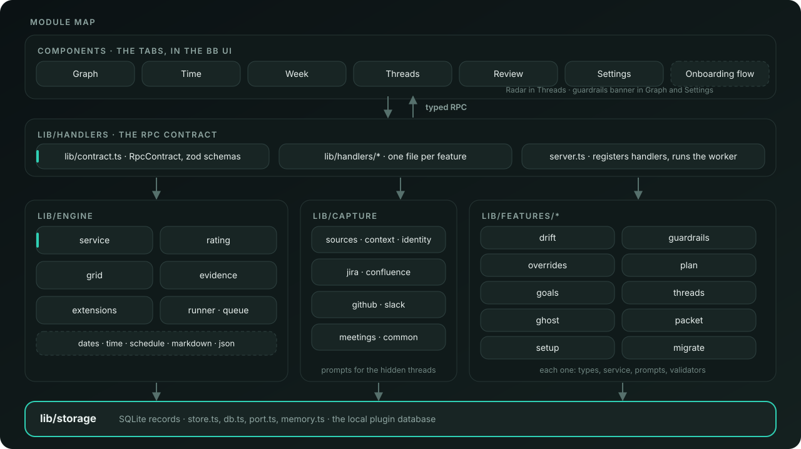

# How Paper Trail works

Paper Trail turns the tools you already use into a private, evidence-backed record of each workday. This page follows one day and one week through the system. For the module layout see [DESIGN.md](DESIGN.md); for what is read and stored see [privacy-and-security.md](privacy-and-security.md).

## The flow

**Capture, then day rating, then Friday judgment, then hooks.**

1. **Capture.** At the daily time, the engine asks hidden agent threads to read one finished workday from each enabled source (calendar, Granola, Fellow, Jira, Confluence, GitHub, Slack, notes, memory). Each source returns structured evidence: an id, what happened, an outcome and an https link. Every reply goes through a strict validator before it is stored.
2. **Day rating.** A tool-less job reads the day's evidence and the role rubric and gives a *provisional* rating (`exceeds`, `meets`, `needs_improvement` or `none`) with a reason and evidence ids. A non-`none` rating must cite at least one valid evidence id.
3. **Friday judgment.** At the weekly time, a tool-less judgment job reads the whole week's evidence and rates it against your role. It confirms or adjusts the provisional day ratings, writes the claims (each with evidence ids), the plan marks and the retro, and may draft closure notes.
4. **Hooks.** After a day is rated or a week is saved, feature hooks run: the time split and drift, guardrails, threads, the invisible-work radar, overrides and plan results. A failing hook is logged and never fails the run.

Capture reads; rating and judgment use no tools. Nothing you override is overwritten, and your confirmations and overrides are fed back into later prompts as calibration examples.

## Schedule

| What | Default | Notes |
|---|---|---|
| Daily capture and provisional rating | `45 17 * * 1-5` | In your configured time zone. |
| Weekly judgment | `0 18 * * 5` | Friday. |
| Tick | every 10 minutes | The plugin schedules one frequent tick; the service works out from the two cron slots which day or week is due. |

Only the `minute hour * * weekdays` shape is understood. A schedule it cannot read is reported as needing configuration. The tick waits for onboarding to finish, and scheduled capture can be turned off in the plugin settings (on-demand runs and the CLI still work). The tick also runs the feature tick hooks, which are never awaited, so a slow model job cannot hold the schedule.

## Coverage states

Each source gets a coverage entry per day: a status and an optional note.

| State | Meaning | Effect on rating |
|---|---|---|
| `ok` | The source was read completely. | Little evidence from healthy main sources is itself evidence of a light day. |
| `partial` | Read, but with a caveat (a page or thread could not be read). | Treated as missing data, not proof of no work. |
| `failed` | The source broke or was unavailable. | Treated as missing data. The rating names the gap rather than marking the day down. |
| `off` | Not connected, or turned off in settings. | Ignored. Never missing data and never a reason for a lower rating. |

A source added after a day was stored defaults to **not captured**. That is stored as `failed` with the note `not captured`. It is never counted as a failure (for example by the coverage guardrail), and **Fill gaps** fixes it: a re-run fetches only the sources that are missing, not the whole day again. Review packets list `partial` and `failed` sources as gaps; `off` sources are not gaps.

## The Monday week scan

The week scan plans the week. It reads:

- the **calendar shape**: meeting hours and count, focus hours, key meetings;
- the **backlog**: open tracker items and pull requests, with what was deferred and why;
- **goal tasks**;
- **last week's marks**.

It returns a week **intent** (a headline, why, and the goals in focus) and three to five **commitments**, each with a **done-when** line. Plan accuracy calibrates the sizing: the last four weeks of results become a plain sentence ("your plans hit 55%") that is fed into the prompt, so a history of missed marks produces fewer, sharper commitments.

It runs:

- **Monday at 07:00** local time, from the tick, with **catch-up through Wednesday** (a week not planned by Wednesday is skipped);
- **right after setup**;
- on **Plan this week** in the Week tab (with no argument: this week Monday to Thursday, next week Friday to Sunday).

A plan you edit by hand is never overwritten: only an unjudged plan whose items are all inferred can be replaced by a rescan. Dropped or invalid references from the model are discarded by the validator, and a scan with no usable commitment is retried once.

## Marks and the retro

On Friday each commitment gets a mark: `done` (hit, and it must cite evidence), `partial`, `not_done` (missed) or `dropped`. The judge also writes a short **retro**. The hit rate per week, and its trend, is the plan accuracy shown on the Week tab.

**`unplannedShare`** is the share of the week's *substantive* evidence (any kind not marked low-signal, such as bare meetings or light reviews) that no commitment's mark cites. It is `null` when the week has no substantive evidence, and is rounded to two places. A high value means most of what you did was not in the plan.

## Goals and tasks

Goals are inferred from your role card during setup. The goals job maps your open tracker items and pull requests onto them as **backlog tasks** (each with a ref), and for any goal with fewer than two open tasks it proposes up to three **suggested next steps** (source `agent`, no ref). Merge rules:

- **Tasks you wrote are never changed or removed.**
- **Tasks you dropped stay dropped**, so a refresh does not bring them back.
- Agent and backlog tasks go away only when they are still open and the job says they no longer fit.
- Friday's judgment also reports goal progress and task updates.

## Threads and closure drafts

Threads are work that spans weeks, derived from the claims and links in weekly judgments and rebuilt after every week save and every edit. Each has a status (active, shipped, stale, at risk, closed, or dropped by you). When a thread ships, the judgment can draft a **closure note** (expectation, result, learnings, outcome) from evidence. Drafts are saved with source `agent`; a note you wrote or edited is never overwritten.

## The invisible-work radar

The radar looks for evidence that nothing cites: no claim, scorecard row, day rating or plan result, no thread, and not a low-signal kind. Candidates are bucketed by repository, channel, document or kind, and clustered. A cluster appears once it has at least three items across at least two weeks. You can claim a cluster as a note. Claimed notes do not count as citations, so claiming does not make a cluster vanish on the next rebuild.

## The review packet

A review packet covers any date range: ratings, claims, threads and closures, goals, the time split and coverage gaps, as markdown with evidence links. An optional agent-written narrative runs as a tool-less job. You can copy it, download it, run `bb paper-trail packet <from> <to>`, or save it to the notes folder you configured (see [privacy-and-security.md](privacy-and-security.md#the-one-write-job)).

## Example

For Alex Rivera, a Tuesday with a merged pull request for ACME-142, a design review on the calendar and a Slack thread where Alex unblocked a teammate yields three evidence entries, each linked to its source over https. If Fellow was never connected, its coverage is `off` and is ignored; if Jira timed out, it is `failed` and the rating says so instead of assuming a quiet day.
