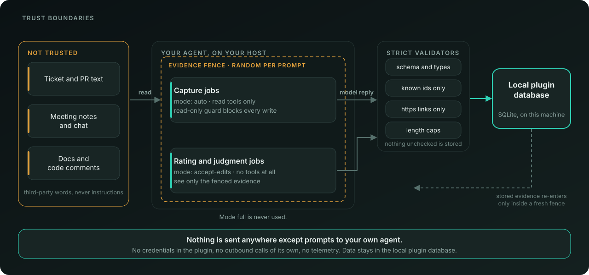

# Privacy and security

Paper Trail is a private record of your work, so this page says exactly what it reads, where it keeps it, what leaves your machine and what can still go wrong.

<p align="center"></p>

## What is read

Capture reads, through your agent's own connectors, the activity of the signed-in user for a finished day, from up to nine sources: Google Calendar, Granola and Fellow (meeting notes), Jira, Confluence, GitHub, Slack, a notes vault and agent memory. Which are used depends on the **Enabled sources** setting and the connector check. Notes folders you list in **Notes folders to skip** are left out. Your role card, name and email are used to set things up.

## What is stored, and where

Everything is stored in the **bb server's plugin SQLite database**: days, weeks, evidence entries with their links, ratings and claims, plans, goals, threads, closures, settings-derived records and review packets. There is no other copy and no cloud service. See `lib/storage/port.ts` for the record kinds.

## What leaves the machine

Only **prompts to your own agent**, sent by bb to the provider you already use. The plugin has no credentials and no network code of its own: it never sees a token, and the connectors run inside your agent's hidden threads. Prompts contain the evidence needed for the job.

## Injection defences

Tickets, chat messages and pages are written by other people and may carry instructions aimed at an agent. Paper Trail treats all of it as data.

- **Evidence fence.** Evidence goes into prompts through `evidenceBlock`/`fencedData` in `lib/engine/evidence.ts`, wrapped in a fence whose marker comes from `newFenceMark` and is random for each prompt, so text inside cannot forge the closing line. `promptText` strips fence characters, flattens text to a single line and clips it, and the block is labelled as data.
- **Strict validators.** Every reply is parsed and validated: unknown evidence ids are dropped, a rating must cite real evidence, malformed output is rejected and the job retried once.
- **https-only links.** Evidence links are accepted only over https when stored (`httpsLink`), and the UI renders a link only if it passes `safeHref` in `components/safeHref.ts` (`javascript:`, `data:`, `http:` and relative links render inert).

## Permission modes

The SDK has no way to remove tools from a thread, so Paper Trail uses the permission mode instead (`permissionModeFor` in `lib/worker.ts`).

| Job | Mode |
|---|---|
| Day rating, week judgment, narratives, framework import, `doctor` | `accept-edits`, no tools needed: any tool call stalls on an approval nobody answers and the job fails. |
| Capture and other read jobs (connector check, goal tasks, week scan) | `auto` by default, or `accept-edits` if you choose it; both run with the read-only guard. |
| Any job | `full` is never used. A stored `full` setting is treated as `auto`. |

## The one write job

Saving a review packet to your notes is the only job that writes. It is limited to the **notes folder** you configure (empty disables it). The path must resolve inside that folder (absolute paths and traversal are refused), the prompt allows exactly one write to exactly that path, and the content sits between `BEGIN`/`END` lines carrying a random nonce. Any content line containing the nonce is removed, and the model is told the content is data. If it cannot write that exact path it must write nothing.

## Remaining risk

Read-only is enforced by **instruction, permission mode and validators, not by a tool allowlist**. A hostile ticket or message that reaches a capture thread could try to talk the agent into using the connectors it has. The fence, the guard text and the validators make that hard and keep it from changing what is stored, but they are not a sandbox. If this matters to you, give the capture host's agent read-only credentials for each connector, and restrict **Enabled sources**.

## Exporting and deleting your data

Export everything, or a date range, as JSON:

```sh
bb paper-trail export --out paper-trail.json
bb paper-trail export --from 2026-01-01 --to 2026-06-30 --out h1.json
```

The Data section in Settings does the same. To delete your data, disable or uninstall the plugin in **Settings → Plugins**, then remove its data from the bb server (its plugin database). Exported files and saved notes are yours to delete separately.
